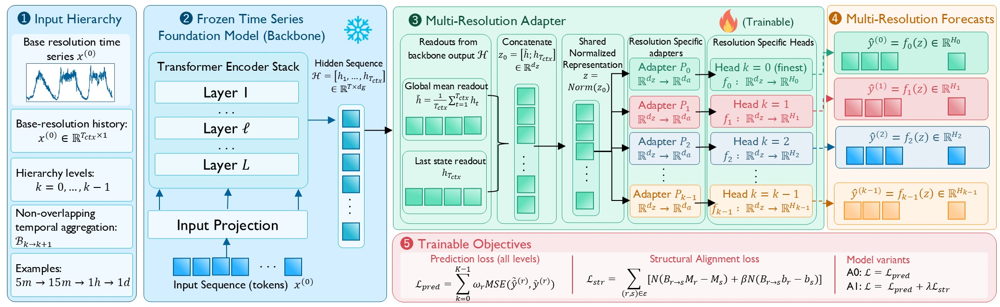

<h1 align="left">
  
  LACE
</h1>


A framework for studying and improving cross-resolution self-consistency in time-series foundation models (TSFMs).

### Three questions behind LACE 

>**Do TSFM forecasts agree across resolutions?** \
**Does disagreement matter downstream?** \
**Can we improve agreement while preserving useful forecasts?** 


## Implementation

LACE adapts a frozen time-series foundation model through resolution-specific
adapter–head pathways, with structural alignment across aggregation-linked
resolutions. This implementation supports Moirai-1, Moirai-2, Chronos-2, and
TimesFM-2.

<p align="center">
  
</p>


## Using LACE

LACE can be applied wherever forecasts are needed at several aggregation-linked temporal resolutions that describe the same physical future.

To use it on your own data:

1. **Define the hierarchy:** choose the input resolution and the physical forecast horizon. For 5-minute data, forecasting the next day gives `pred_len = 288`. Factors `[1, 3, 12, 288]` then define 5-minute, 15-minute, hourly, and daily outputs, with lengths `[288, 96, 24, 1]`.

2. **Prepare the data:** pair each input window—for example, seven days of 5-minute observations (`2016` samples)—with the following day’s `288` observations. Construct the coarser targets by summing groups of `3`, `12`, and `288` within that same future window. Use chronological splits and fit normalization on the training period only.

3. **Train and forecast:** keep the TSFM frozen and train the resolution-specific adapters and heads using forecasting accuracy and structural alignment losses. Select the checkpoint using validation data. At inference, one 5-minute input history produces forecasts at all four resolutions.

See the [paper](#paper) for the structural alignment objective, **L = L<sub>acc</sub> + λ<sub>str</sub> L<sub>str</sub>**, where **λ<sub>str</sub>** (`--lace_lambda` in the code) controls the strength of structural alignment relative to forecasting accuracy.


## Asking “Do TSFMs agree?” in another domain

Our paper examines cross-resolution forecast agreement of TSFMs and its operational consequences in network traffic, electricity, and road traffic.

To investigate **“Do TSFMs agree?”** in another domain, use the [evaluation code](src/evaluator/) and follow the diagnostic protocol in the [paper](#paper) adapting the decision policies and metrics to your application.

## Repository contents

| Location | Contents |
|---|---|
| [src/lace/](src/lace/) | LACE model, backbone interfaces, hierarchy, and losses |
| [src/models/](src/models/) | Four LACE backbone wrappers and forecasting baselines |
| [src/exp/](src/exp/) | Training and inference |
| [src/data_provider/](src/data_provider/) | Data loading, chronological splits, and normalization |
| [src/evaluator/](src/evaluator/) | Forecast evaluation, decision metrics, reconciliation, and statistical analysis |
| [scripts/](scripts/) | Experiment launch scripts |
| [configs/paper_protocol.json](configs/paper_protocol.json) | Paper configurations for accuracy-only (A0) and structural alignment (A1) runs |
| [tools/](tools/) | Dataset preparation and environment capture |
| [notebooks/](notebooks/) | Dataset preparation notebooks |
| [tests/](tests/) | Offline regression tests and pretrained-backbone integration checks |
| [docs/](docs/) | Dataset preparation and reproduction guides |


## Quick start

The implementation was tested with Python 3.11.15, PyTorch 2.6.0, and
uni2ts 2.0.0. Install the appropriate PyTorch 2.6.0 build for your machine, then:

```bash
python -m pip install -r requirements.txt
python -m pip install -r requirements-backbones.txt
python run.py --help
```

Prepare CESNET, ETTm1, or PeMSD4 as described in [DATASETS.md](docs/DATASETS.md). Preview the
Moirai-1 experiment commands without starting training:

```bash
bash scripts/run_lace_overnight.sh --dry-run
```

Run one dataset with structural alignment:

```bash
ONLY_DATASET=ETTm1_HUFL ONLY_MODE=structural MODEL_NAME=LACE_moirai1 bash scripts/run_lace_overnight.sh
```

The other backbone options are `LACE_moirai2`, `LACE_chronos2`, and
`LACE_timesfm2`. The accuracy-only ablation uses `ONLY_MODE=none`.

See [REPRODUCIBILITY.md](docs/REPRODUCIBILITY.md) for the experiment matrix,
reconciliation, evaluation, sensitivity runs, and tests. 


## Paper

E. Babai and K. Okamura. *Do Time-Series Foundation Models Agree Across Temporal
Resolutions? Cross-Resolution Reliability and Structural Alignment with LACE.*
Manuscript submitted to **Forecasting**.

The MDPI DOI and final bibliographic details will be added soon. See [CITATION.cff](CITATION.cff)
and [CITATION.bib](CITATION.bib). 

## License

The original LACE contributions are released under the [MIT License](LICENSE).
Upstream copyright and license notices are preserved in
[THIRD_PARTY_NOTICES.md](THIRD_PARTY_NOTICES.md) and `third_party/`.
Downloaded models and datasets retain their own terms.
